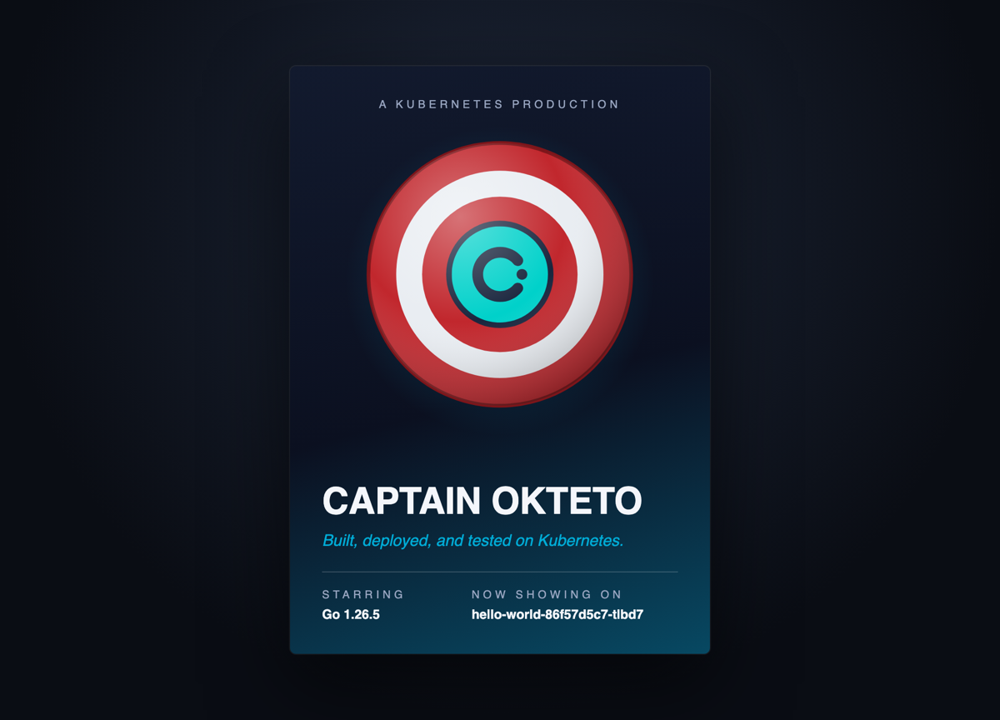

# Getting Started with Okteto and Go

This sample shows how to build, deploy, test, and develop a Go application on Kubernetes with [Okteto](https://www.okteto.com). The application is the poster of a movie, *Captain Okteto*, that shows the Go version and the pod that serves it.

Okteto builds its application and development images from the `Dockerfile`, deploys it with `kubectl`, runs its unit tests in the cluster, and replaces it with a Development Container that has hot reload and a debugger.

Follow the [Getting Started with Okteto and Go](https://www.okteto.com/docs/development/containers/golang/) guide.
